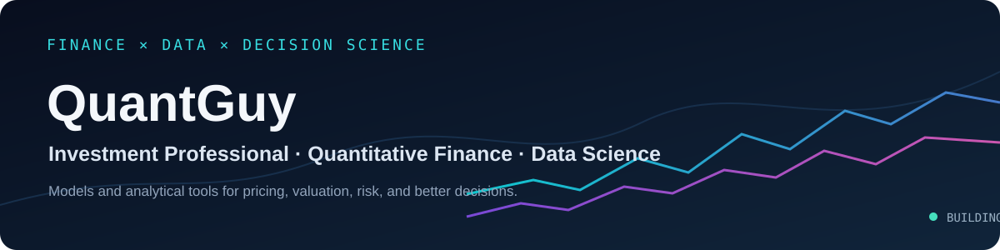

<p align="center">
  
</p>

<p align="center">
  <a href="https://thatquantguy44.github.io"></a>
  <a href="https://github.com/thatquantguy44"></a>
  
  
</p>

<p align="center">
  <a href="https://github.com/thatquantguy44/QuantMeridian-Core"></a>
  <a href="https://github.com/thatquantguy44/QuantSmith"></a>
  <a href="https://github.com/thatquantguy44/QR-Haven"></a>
</p>

<hr />

## 👨‍💻 About me

```python
class QuantGuy:
    role = "Investment professional & data scientist"
    focus = ["pricing", "valuation", "risk", "decision support","quant-trading","hedging"]
    tools = ["Python","C++","Rust", "SQL", "SAS", "Power BI", "Tableau"]
    education = ["MS Computer Science" ,"MS Financial Economics", "BS Economics"]  # Texas A&M University & Georgia Tech
    credentials = ["CFA Charterholder"]
```

I build quantitative models, data pipelines, and dashboards that help turn complex financial information into practical decisions. My work spans pricing and valuation models, alternative data, data quality, and analytics for business teams.

## 📌 Areas I enjoy

- **Financial modeling:** pricing, valuation, fixed income, and risk analysis
- **Data science:** predictive modeling, text mining, data cleaning, and time-series analysis
- **Decision tools:** dashboards, automated reporting, and reusable analytical workflows
- **Investing and corporate finance:** practical and theoretical perspectives on markets and businesses

## 🌟 Featured projects

| Project | What it is |
| --- | --- |
| [QuantMeridian Core](https://github.com/thatquantguy44/QuantMeridian-Core) | A macro and market intelligence terminal for rates, curves, inflation, credit, regimes, volatility, news, and an AI copilot over macro data. |
| [QuantSmith](https://github.com/thatquantguy44/QuantSmith) | A spec-driven, agentic SDK for building reproducible quant research and models with traceable specs and leakage-aware workflows. |
| [QR Haven](https://github.com/thatquantguy44/QR-Haven) | Quant research infrastructure with transaction-cost models, alpha signals, walk-forward backtesting, portfolio optimization, and regime detection. |

## 🎓 Background

- M.S. in Financial Economics and B.S. in Economics, **Texas A&M University**
- **CFA charterholder**, earned in 2021
- Google Professional Data Analytics Certificate
- DataCamp Data Scientist Career Track

## 🤝 Outside of work

I care about economic empowerment and Junior Achievement, and I’m always glad to connect with people working on finance, investing, analytics, and risk.

<p align="center"><a href="https://github.com/thatquantguy44">More on GitHub →</a></p>
